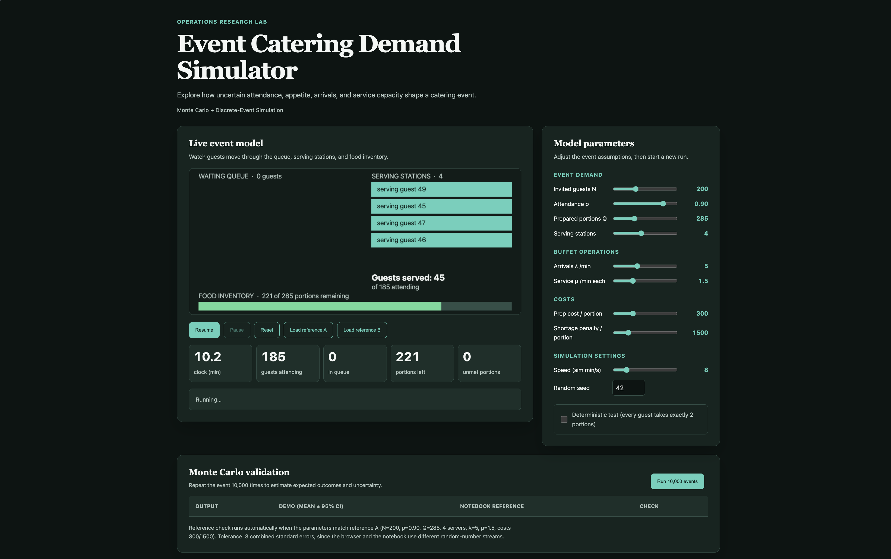
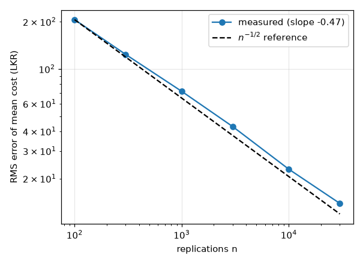
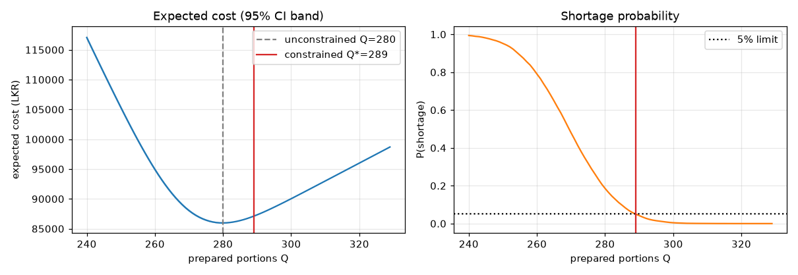

# Event Catering Demand Simulator

A Monte Carlo and discrete-event simulation that finds how many portions an event caterer should prepare when guest attendance and appetite are uncertain.

**[Live demo](https://VidathTheekshana.github.io/event-catering-demand-simulator/)** · [](https://colab.research.google.com/github/VidathTheekshana/event-catering-demand-simulator/blob/main/notebook/event_catering_simulator.ipynb)

The live web demo is shown below, with the live event model, adjustable parameters and Monte Carlo validation panel.



## The problem

Event caterers in Sri Lanka typically cook against advance guest bookings. On the day, nobody knows exactly how many invited guests will turn up or how many portions each will take. Cook too little and guests go without; cook too much and ingredients are wasted. Food service is a large part of the global food-waste problem: the UN Environment Programme estimates it accounted for about 290 million of the 1.05 billion tonnes of food wasted worldwide in 2022 [5].

**Question:** for an event with 100 to 500 invited guests, how many portions should be prepared to minimise expected cost while keeping the probability of *any* shortage at or below 5%, and how sensitive is that answer to attendance, appetite variability and the cost assumptions?

## Quick start

**Notebook:** click the *Open in Colab* badge above, then *Runtime → Run all*. Everything installs and runs in about 4 minutes on a free runtime.

**Web demo:** open the [live demo](https://VidathTheekshana.github.io/event-catering-demand-simulator/), or download this repository and double-click `docs/index.html`.

**Run locally (optional):**

```bash
pip install -r requirements.txt
jupyter notebook notebook/event_catering_simulator.ipynb
```

## Using the demo

Pick the number of invited guests, attendance rate, prepared portions and serving stations, press **Start**, and watch guests queue at the buffet while the food bar drains. **Run 10,000 events** reports mean unused food, shortage probability, cost and waiting time with 95% confidence intervals. Full guide: [USER_GUIDE.md](USER_GUIDE.md).

## Model and mathematics

Attendance is $A \sim \text{Binomial}(N, p)$ and each attendee takes $X$ portions from a discrete distribution, so total demand is $D=\sum_{i=1}^{A} X_i$. With prepared quantity $Q$, the cost is

$$C(Q) = c_\text{prep}\,Q + c_\text{short}\,(D-Q)^+ ,\qquad Q^\* = \arg\min_Q E[C(Q)]\ \text{ s.t. }\ P(D>Q)\le 0.05 .$$

Candidate quantities are compared on the same simulated events (common random numbers) and searched by grid. A next-event discrete-event simulation of the buffet (arrivals, queue, service completions, inventory depletion) adds queueing delay and stock-out timing. Full derivations, assumptions and parameters: [THEORY.md](THEORY.md).

## Verification

Every check is an `assert` in the notebook. Highlights (Colab run, seed 42):

| Check | Expected | Obtained |
|---|---|---|
| Mean attendance $E[A]=Np$ | 180.000 | 180.000 |
| M/M/1 mean queue wait ($\lambda=6$, $\mu=8$) | 0.3750 min | 0.3735 ± 0.0071 |
| M/M/4 mean queue wait (the buffet settings) | 0.6577 min | 0.6596 ± 0.0192 |
| Hand-solved optimisation case | $Q=3$ (cost 3.250), $Q=4$ with 5% limit | 3 (3.249), 4 |
| Grid optimum vs newsvendor quantile | 280 | 280 |
| Monte Carlo error slope (log-log) | −0.5 | −0.475 |

The verification table above reports the analytic queueing checks. The figure below provides an additional verification by showing that the Monte Carlo estimation error decreases approximately as \(n^{-1/2}\). The fitted log-log slope is −0.475, close to the theoretical value of −0.5.



## Concepts applied

This project applies input modelling and random variate generation (Binomial attendance, Multinomial portion counts, inverse-transform exponential arrival and service times); Monte Carlo estimation with 95% confidence intervals based on the law of large numbers, including the $n^{-1/2}$ error scaling; and next-event time-advance discrete-event simulation of an M/M/c buffet queue with inventory depletion. The simulator is verified against analytic M/M/1 and Erlang-C waiting times, a hand-solved optimisation, the newsvendor critical-fractile quantile, and conservation of food portions in every run.

## Results

Baseline: $N=200$ invited, $p=0.9$, so expected demand is 270 portions. The cost-only optimum is 280, but the 5% shortage limit binds and raises the recommendation to **$Q^\*=289$** (about 7% above expected demand).

| Invited $N$ | $E[D]$ | $Q^\*$ | Buffer above $E[D]$ |
|---|---|---|---|
| 100 | 135 | 149 | 10.4% |
| 200 | 270 | 289 | 7.0% |
| 300 | 405 | 429 | 5.9% |
| 400 | 540 | 568 | 5.2% |
| 500 | 675 | 706 | 4.6% |

- The relative safety buffer shrinks as events grow, roughly like $1/\sqrt{N}$.
- While the 5% limit binds, $Q^\*$ depends on attendance and consumption variability, **not** on the assumed cost values.
- A multi-category menu (rice, meat, vegetables) with a 5% limit on each dish leaves an 11.7% chance that some dish runs short; tightening each dish to 5%/3 brings the menu-level risk to 4.5%.



## Limitations and future work

- Every cost, appetite, arrival and service parameter is assumed, not measured. Real booking and attendance records would let the model be calibrated and validated.
- Guests are treated as independent. Real groups (families, tables) are correlated, which would widen demand uncertainty and raise the required buffer.
- A single preparation decision is modelled: no top-up cooking during the event.

## Key references

1. A. M. Law, *Simulation Modeling and Analysis*, 5th ed. McGraw-Hill Education, 2015.
2. K. J. Arrow, T. Harris, and J. Marschak, "Optimal inventory policy," *Econometrica*, vol. 19, no. 3, pp. 250–272, 1951, doi: 10.2307/1906813.
3. N. Metropolis and S. Ulam, "The Monte Carlo method," *J. Amer. Statist. Assoc.*, vol. 44, no. 247, pp. 335–341, 1949, doi: 10.1080/01621459.1949.10483310.

Full list: [REFERENCES.md](REFERENCES.md).

## AI assistance

Developed with the help of AI coding and writing assistants. All code was reviewed, run and verified by the author.

## Licence and credits

Code: [MIT](LICENSE). No external datasets are used; all parameters are documented assumptions. Background statistic: UNEP, *Food Waste Index Report 2024*.
