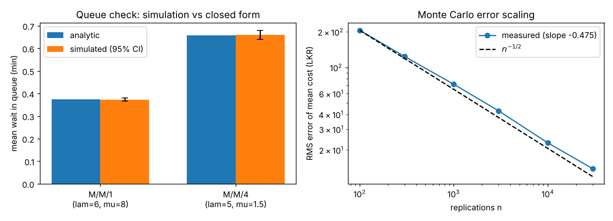
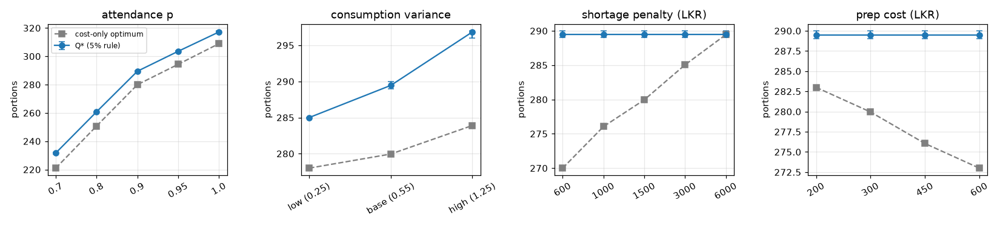

# Theory and mathematics

## 1. Problem formulation

A caterer must choose, before the event, the number of food portions $Q$ to prepare for $N$ invited guests. Attendance and the portions each guest takes are random. The quantities of interest are the expected total cost, the expected unused (leftover) portions, the probability that any guest is short-served, and the queueing delay at the buffet. The decision is the smallest-cost $Q$ whose shortage probability is at most $\alpha = 0.05$.

## 2. Assumptions

1. Each invited guest attends independently with probability $p$ (Bernoulli trials, so Binomial attendance).
2. Each attendee takes $X\in\{0,1,2,3\}$ portions, i.i.d., with probabilities $(0.05,\,0.50,\,0.35,\,0.10)$ and mean $\mu_X=1.5$.
3. Attendees arrive as a Poisson stream of rate $\lambda$, truncated after the $A$ attendees, and queue FIFO for $c$ serving stations with exponential service of rate $\mu$ each.
4. Food is taken when a guest's service completes. If stock is short the guest receives what remains and the rest is *unmet demand* (partial service).
5. Preparation is fixed before the event (single period, no re-cooking). Leftovers cost only their preparation cost.
6. **All numerical parameters are assumed**, not measured. They are documented below and varied in the sensitivity study.

## 3. Model equations

**Attendance and demand.**

$$A\sim\text{Binomial}(N,p),\qquad D=\sum_{i=1}^{A}X_i .$$

Given $A$, the numbers of guests choosing each portion size follow $\text{Multinomial}(A,\boldsymbol\pi)$ and $D=\sum_k v_k n_k$, which is sampled in one vectorised draw. By the law of total variance

$$E[D]=Np\,\mu_X,\qquad \operatorname{Var}(D)=Np\,\sigma_X^2+Np(1-p)\,\mu_X^2 .$$

**Cost and decision.**

$$C(Q)=c_\text{prep}\,Q+c_\text{short}\,(D-Q)^+,\qquad Q^\*=\arg\min_{Q}\,E[C(Q)]\ \ \text{s.t.}\ \ P(D>Q)\le\alpha .$$

Because $(D-Q-1)^+-(D-Q)^+=-\mathbf 1[D>Q]$,

$$E[C(Q+1)]-E[C(Q)]=c_\text{prep}-c_\text{short}\,P(D>Q),$$

so $E[C]$ is convex in $Q$ and the unconstrained optimum is the smallest $Q$ with $F_D(Q)\ge 1-c_\text{prep}/c_\text{short}$ (the newsvendor critical fractile [2], [4]). Let $Q_\alpha$ be the smallest $Q$ with $P(D>Q)\le\alpha$. By convexity the constrained optimum is

$$Q^\*=\max\left(Q_\text{cost},\,Q_\alpha\right),$$

so the shortage limit binds exactly when $c_\text{short}<c_\text{prep}/\alpha=20\,c_\text{prep}$.

**Queue (verification formulas).** With $a=\lambda/\mu$ and $\rho=\lambda/(c\mu)<1$:

$$W_q^{M/M/1}=\frac{\lambda}{\mu(\mu-\lambda)},\qquad W_q^{M/M/c}=\frac{C(c,a)}{c\mu-\lambda},\quad C(c,a)=\frac{\frac{a^c}{c!}\frac{1}{1-\rho}}{\sum_{k=0}^{c-1}\frac{a^k}{k!}+\frac{a^c}{c!}\frac{1}{1-\rho}} .$$

**Monte Carlo estimation [1], [3].** For $n$ independent replications with costs $C_j$:

$$\hat C=\frac1n\sum_{j=1}^n C_j,\qquad \text{95\% CI}=\hat C\pm1.96\frac{s}{\sqrt n},\qquad \text{RMS error}\propto n^{-1/2}.$$

| Symbol | Meaning | Units | Value / range | Source |
|---|---|---|---|---|
| $N$ | invited guests | guests | 100 to 500 (baseline 200) | scenario |
| $p$ | attendance probability | – | 0.7 to 1.0 (baseline 0.9) | assumed |
| $X$ | portions per attending guest | portions | $\{0,1,2,3\}$, mean 1.5 | assumed |
| $Q$ | prepared portions | portions | decision variable | – |
| $c_\text{prep}$ | preparation cost | LKR/portion | 300 (200 to 600) | assumed |
| $c_\text{short}$ | shortage penalty | LKR/unmet portion | 1,500 (600 to 6,000) | assumed |
| $\lambda$ | guest arrival rate | guests/min | 5 | assumed |
| $\mu$ | service rate per station | guests/min | 1.5 | assumed |
| $c$ | serving stations | – | 4 | assumed |
| $\alpha$ | shortage-probability limit | – | 0.05 | design target |

## 4. Numerical method

- **Fast layer.** Draw $n=10{,}000$ demand values $D$, then evaluate every candidate $Q$ on the *same* draws (common random numbers), which removes sampling noise from comparisons between quantities. The optimum is found by grid search over integer $Q$.
- **Discrete-event layer.** A next-event simulation keeps a clock, busy-server count, FIFO queue, inventory and a future-event list (binary heap). The clock jumps to the earliest event. Ties are broken deterministically: departures before arrivals, then insertion order. Arrival gaps use inverse-transform sampling, $T=-\ln(U)/\lambda$.
- **Run-time conservation.** In every run the code asserts prepared = served + leftover and requested = served + unmet.
- **Sample size.** 10,000 replications per scenario, which gives 95% half-widths of about 0.2 portions on unused food and 0.004 on shortage probability. Sensitivity results repeat the whole optimisation over 20 seeds.
- **Cost.** The full notebook runs in about 3.5 minutes on a free Colab runtime; 10,000 simulated events take a few seconds.

## 5. Verification

| Check | Expected | Obtained | Pass? |
|---|---|---|---|
| Mean attendance $E[A]=Np$ | 180.000 | 180.000 | yes |
| $E[D]$ and $\operatorname{Var}(D)$ | 270.000 and 139.5 | 270.022 and 139.6 | yes |
| Deterministic limit ($N=50$, $p=1$, 2 portions each) | requested 100; $Q=90$ gives unmet 10 | 100; 10 | yes |
| Conservation, 10,000 DES runs | exact | exact | yes |
| DES vs fast layer, mean leftover at $Q=285$ | agree within 3 SE | 15.58 vs 15.59 | yes |
| DES vs fast layer, mean cost at $Q=285$ | agree within 3 SE | 86,330 vs 86,357 LKR | yes |
| M/M/1 queue wait ($\lambda=6,\mu=8$) | 0.3750 min | 0.3735 ± 0.0071 | yes |
| M/M/4 queue wait ($\lambda=5,\mu=1.5$) | 0.6577 min | 0.6596 ± 0.0192 | yes |
| Hand-solved case ($N=4,p=0.5$, costs 1 and 4) | $Q=3$ (cost 3.25), $Q=4$ with 5% limit | 3 (3.249), 4 | yes |
| Grid optimum vs newsvendor quantile | 280 | 280 | yes |
| Monte Carlo error slope | −0.5 | −0.475 | yes |
| Web demo vs notebook reference (5 seeds) | within 3 combined SE | all metrics agree | yes |

## 6. Concepts applied

| Concept | Where it is used in this project |
|---|---|
| Input modelling and random variate generation | Binomial attendance, Multinomial portion counts, exponential arrival and service times by inverse transform (notebook sections 2 to 3) |
| Monte Carlo estimation and the law of large numbers | 10,000-replication estimates with 95% CIs on every result; $n^{-1/2}$ convergence study (sections 4 and 5) |
| Next-event discrete-event simulation and queueing | Buffet queue, event list, inventory depletion; M/M/1 and Erlang-C checks (sections 3 and 4) |

## 7. Further analyses

**Sensitivity (one at a time, 20 seeds).** Mean $Q^\*$ with the 5% limit, against the cost-only optimum:

| Parameter | Setting | $Q^\*$ | Cost-only optimum |
|---|---|---|---|
| attendance $p$ | 0.7 / 0.8 / 0.9 / 0.95 / 1.0 | 231.7 / 260.8 / 289.4 / 303.6 / 317.2 | 221.0 / 250.8 / 280.0 / 294.4 / 309.0 |
| portion variance | 0.25 / 0.55 / 1.25 | 285.0 / 289.4 / 296.8 | 278.0 / 280.0 / 283.9 |
| shortage penalty (LKR) | 600 to 6,000 | 289.4 throughout | 270.0 rising to 289.4 |
| preparation cost (LKR) | 200 to 600 | 289.4 throughout | 283.0 falling to 273.0 |

Attendance and consumption variability drive $Q^\*$. The cost assumptions move the total bill and the cost-only optimum but not $Q^\*$ while the 5% limit binds.

**Multi-category menu.** Rice, meat and vegetables each have their own portion distribution, preparation cost and shortage penalty, with attendance shared. A 5% limit per dish gives a 11.7% chance that some dish runs short; a 5%/3 limit per dish gives 4.5%.

## 8. References

See [REFERENCES.md](REFERENCES.md).
